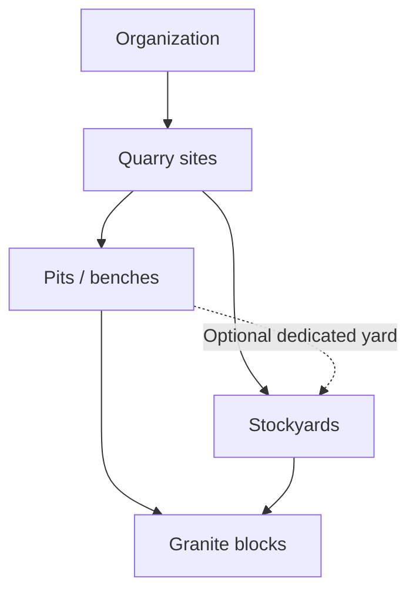

# QuarryOne V0.4.1.1 — Configurable onboarding

Current mobile milestone: V0.4.3A.4 implements Materials, Grades, Stockyards and Measurement Preferences in Step 3 of the existing session-only wizard through **More → Demo Business Setup**. The [Step 3 report](../verification/v043a4/README.md) describes supported materials, fixed A/B/C grades, ID-based shared/dedicated stockyards and FT/M/CFT/m³ draft preferences. It reuses the existing [foundation](../verification/v043a1/README.md), [Business Registration](../verification/v043a2/README.md), [Quarry Setup](../verification/v043a3/README.md) and [editable prefill/code](../verification/v043a3-1/README.md) behavior. Users & Roles and Review & Activate remain placeholders. There is no authentication, server save, invitation delivery or activation. Local catalog/site/pit/stockyard IDs, business district/address and draft codes still require separately reviewed server mapping before persistence; database UUIDs and canonical m³ calculations are unchanged. Operational behavior is unchanged. Hosted deployment/security acceptance status is tracked separately in the [Supabase rollout plan](SUPABASE_ROLLOUT_PLAN.md).

Historical architecture baseline: the specification below was proposed against local SQL drafts before onboarding UI or hosted project deployment. Its future server-save, invitation and lifecycle contracts remain separate from the new in-memory prototype; navigation progress does not establish readiness or authorization.

## Organization and site model

An organization is the tenant boundary. Every business gets site-capable tables from day one; `organization_settings.multi_site_enabled BOOLEAN NOT NULL DEFAULT FALSE` controls the experience, not permission checks.

Each block belongs to one organization, site, pit and stockyard. Stockyards are site-scoped and may optionally serve one pit; a shared site yard can receive blocks from multiple pits. Dedicated-yard assignments must agree with the block's pit. This avoids incorrectly forcing every physical stockyard into a single pit while retaining the requested hierarchy.

One primary quarry site is mandatory before review/activation. Single-site mode automatically binds future operational forms to that site and omits site pickers. It must never suppress accessible historical records. Multi-site mode shows authorized site choices only; it does not grant access to another site or organization.

## Five stages

| Stage                                                        | Mandatory before review                                                                                                                   | Optional / defaults                                                                                                                   |
| ------------------------------------------------------------ | ----------------------------------------------------------------------------------------------------------------------------------------- | ------------------------------------------------------------------------------------------------------------------------------------- |
| 1. Business Registration                                     | Verified non-anonymous owner identity, owner display name, business name, contact phone, business state                                   | Legal name, GSTIN; INR and Asia/Kolkata defaults                                                                                      |
| 2. Quarry Site Configuration                                 | One primary site; site name/code, state/district, at least one active pit or bench at each configured site                                | Address, extra pits; multi-site off by default; extra sites only after enabling                                                       |
| 3. Materials, Grades, Stockyards and Measurement Preferences | At least one supported material; grades A/B/C; at least one active stockyard at each configured site; valid units, precision and timezone | FT dimensions/CFT display; CFT 2 and m³ 3 display decimals; site overrides inherit organization defaults; dedicated-pit yard optional |
| 4. Users and Roles                                           | At least one active owner; ownership and any site grants must be unambiguous                                                              | Owner-only business may skip invitations; other staff and site assignments optional                                                   |
| 5. Review and Activation                                     | All previous stage requirements revalidated on server                                                                                     | Review summary, edit links; no production opening balances required to activate                                                       |

DRAFT rows may be incomplete. Business phone/state and site location fields can be null until review; defaults allow preferences to be usable immediately. Unfinished invitations must not prevent an owner-only business activating, and never create effective memberships.

## Lifecycle and saving

`DRAFT → READY_FOR_REVIEW → ACTIVE`. A reviewer may return READY_FOR_REVIEW to DRAFT to correct configuration. ACTIVE cannot revert to DRAFT, and DRAFT cannot skip review. Operational data is accepted only by future authorized write operations for ACTIVE organizations and OPERATIONAL sites. New sites created later remain SETUP until separately validated and activated.

Proposed UI save contract: save an explicit field whitelist for the current stage in a short server transaction, require an expected settings revision, lock the organization first, validate supplied fields but allow missing later-stage fields, increment the revision and return the saved stage/revision. Resume by reading authoritative draft rows and recomputing completion; `onboarding_stage` is a navigation bookmark, not proof of readiness. Concurrent stale saves return a conflict and prompt refresh. A failed save retains entered fields and offers retry; no silent discard or premature success.

The SQL prototypes include idempotent bootstrap, site creation, mode switching, lifecycle transitions and existing-member/site-grant changes. Stage-field save, profile editing, invitation delivery/acceptance and new-site activation contracts are specified here for later implementation; they are deliberately not exposed as generic JSON-to-row update functions. SQL fixtures simulate trusted stage saves for validation. No app persistence or server integration is added now.

Bootstrap uses a caller-generated request UUID plus the verified `auth.uid()`. The same user/key/business name/owner display name returns the same organization; mismatched semantic-payload reuse fails. It atomically creates the profile if missing, organization, settings, fixed OWNER/ALL_SITES membership and audit event. There is no caller-supplied owner ID or role. Existing profile display names are retained. Rate limits and abandoned-draft cleanup belong in the later server rollout.

Review and activation each lock the organization, recheck current admin membership after lock acquisition, check the expected revision and inspect actual configuration. READY_FOR_REVIEW records reviewed_revision. Activation rejects a changed snapshot even when a caller refreshes to the latest revision. Role/site-grant changes remain possible for security, but invalidate that review until DRAFT → READY_FOR_REVIEW is completed again. Additional-site creation and permission changes advance revision. Activation creates no blocks, customers, balances or fabricated operating history; it marks configured SETUP sites OPERATIONAL. Activation timestamps and audit events are written in the same transaction.

## Future stage-save contract (specified, not implemented)

Proposed request: `save_onboarding_stage(organization_id, stage, expected_revision, request_id, payload)` under a verified user JWT. No owner ID, lifecycle, computed volume, audit actor or SQL/table names are accepted. Stages 1–4 are draft-save operations; stage 5 calls the existing review/activation prototypes instead. Unknown payload keys fail rather than being silently discarded.

| Stage | Explicit payload whitelist                                                                                                                                                     |
| ----- | ------------------------------------------------------------------------------------------------------------------------------------------------------------------------------ |
| 1     | business_name, legal_name, contact_phone, state_name, optional gstin; owner profile edit is a separate self-only contract                                                      |
| 2     | same-tenant existing site IDs or new request-local identifiers, site code/name/location, pit name/kind; primary-site changes and mode changes use dedicated guarded operations |
| 3     | supported material selections, A/B/C descriptions, yard name/dedicated pit, organization/site dimension and display preferences/decimals/timezone                              |
| 4     | draft invitation intents (recipient, role, allowed sites), not effective memberships; existing role/site permissions continue through the controlled operations                |

Server order: resolve auth.uid → authorize Owner/Admin → lock organization → recheck membership → look up caller/org/request idempotency receipt → validate the stored payload fingerprint and return an existing committed receipt → for a new command, check DRAFT and expected revision → validate supplied fields/references → apply all changes → increment revision exactly once → audit before/after identifiers and supplied fields → persist the receipt/result → commit. Receipt lookup precedes revision validation so successful-save retries do not fail against their own older revision. New request-local entity identifiers are resolved in the same transaction, never trusted as another tenant's UUID. Missing future-stage fields are allowed while required supplied values and numeric/unit fields remain validated. Partial success is forbidden. Changed payload with the same key fails; stale new commands return conflict. A duplicate receipt does not repeat writes or audit, and a now-revoked administrator cannot replay it.

The future receipt, draft-invitation and outbox tables are not present yet and require their own reviewed migration/retention rules. The contract is not an executable generic JSON update escape hatch. Master-data identity/site/tenant columns and all block dates/numbering remain protected by the existing constraints/guards. Decide deletion/archive/correction semantics explicitly before exposing stage edits against referenced records.

## Future invitation-acceptance contract (specified, not implemented)

Proposed request: `accept_organization_invitation(token, request_id)` with a verified non-anonymous JWT. Tenant, recipient ID, role and site grants come only from the persisted invitation and signed identity, never from caller fields or user_metadata. A future trusted service stores a cryptographically random token hash, normalized verified recipient/channel, immutable organization/role/scope/site IDs, issuer, expiry, revoked/accepted state and acceptance receipt. Raw tokens are never returned in directory queries or audits.

Transaction order: resolve candidate token without disclosing a tenant directory → lock organization, then invitation (consistent lock order) → recheck invite state/expiry/verified recipient and current inviter permission → reject Owner/Admin invites from non-Owners → check all site references and mode configuration → create/update only the recipient's own profile → create one membership and approved same-org grants → bump revision/invalidate review snapshot → mark accepted with recipient and request receipt → audit → commit. Concurrent redemption has one winner; a same-recipient/same-request retry returns that committed acceptance, while changed payload or another identity fails. Existing membership must not be silently escalated/reactivated by an invitation: reject and require an explicit Owner/Admin membership action. Suspended inviters, revoked/expired tokens and site-scope drift fail without partial membership. The later implementation must preserve last-owner rules and canonical role/scope constraints.

For an already accepted invitation, match the verified recipient and request receipt before treating the token as expired/used. Return only that committed acceptance receipt if the recipient's membership is still active; do not regrant roles/sites or reactivate a suspended user. A different request/identity receives an already-used denial. Refetch current membership for access decisions instead of using role data from the historical receipt. These replay semantics are proposed for review alongside token expiry/retention policy.

Delivery happens separately after commit through a future outbox with retry deduplication. Phone/email channel choice, normalization, expiry duration, draft activation policy and retention are review decisions. No invitations are sent and no acceptance/delivery endpoint is implemented here.

## Single-site to multi-site upgrade workflow

1. Owner/Admin opens Settings → Quarry Management and reviews the implications.
2. The controlled operation checks authoritative membership and an expected revision, locks the organization, enables multi-site and audits the change.
3. Primary site, block identities, production dates, permissions and financial history are preserved; no rows are moved or copied.
4. Admin creates additional SETUP sites, configures their pits/yards and grants staff access explicitly. New-site activation remains a later controlled operation.
5. Future site selectors use allowed sites, with an All authorized sites choice for permitted consolidated reporting.

Disabling is a controlled transition, never a direct client setting update. Reject it if there is more than one non-archived site, any block history outside the primary site, or any site membership outside the primary site (including inactive grants). Empty, unassigned archived setup sites are harmless; archived sites with history are not. The drafts never remove history, revoke grants or reassign blocks to make disabling succeed. Before future Sales/Dispatch/Expenses integration, extend the guard to every site's financial and operational history. The UI should show the concrete blocker and retain multi-site mode.

## Mobile UI specifications — no screens implemented

Use approved Deep Slate #263238 headers, white navigation/title, Safety Orange #F57C00 primary actions and Stone White #F5F6F4 background. Reuse current cards, labels, numeric keyboards and safe-area patterns. Minimum 48px targets, visible save status, keyboard-safe scrolling, readable inline errors and 360/390/412px acceptance are required for the eventual UI.

| Specification                         | Proposed content and behavior                                                                                                                                                        |
| ------------------------------------- | ------------------------------------------------------------------------------------------------------------------------------------------------------------------------------------ |
| Business Registration                 | Business/owner details; required markers; optional legal/GST fields; Save & continue and Save draft; authentication verification precedes tenant creation                            |
| Single/Multi Quarry Configuration     | Default one quarry; concise optional toggle explaining additional sites; no repeated selector in single-site mode; authorized users alone may change mode                            |
| Quarry and Pit Setup                  | Primary site basics; one pit row by default; add/remove unused setup rows with clear validation; shared or dedicated stockyard choice in the next stage                              |
| Materials and Measurement Preferences | Select supported materials; configure A/B/C descriptions; yard names; FT/M input and CFT/m³ display choices; demonstrate 10×5×4 FT = 200 CFT ≈ 5.66 m³; no rounding of stored volume |
| User Invitations                      | Email or supported verified phone invitation, role, allowed sites, pending/revoked/expired states; owner row fixed; optional Skip for now; no membership until verified acceptance   |
| Review and Activate                   | Business/site/catalog/preferences/roles summary, missing-field links and explicit Activate; server validation authoritative; errors map to the affected stage                        |
| Settings → Quarry Management          | Primary and other sites with SETUP/OPERATIONAL/ARCHIVED labels, mode switch, blocked-disable explanation, add/configure site, assignments and archived-history access                |

Invitation design: a later trusted service stores an expiring, single-use hashed token and immutable organization/role/site scope, verifies the recipient's Auth identity/channel, and transactionally creates a profile/membership/grants with same-tenant constraints. Accepting users cannot override the role or tenant. Only Owner may invite OWNER/ADMIN; Admin may invite operational roles. Delivery is a retriable outbox operation after transaction commit. No invitation SQL, delivery service or authentication UI is deployed in V0.4.1.

## Acceptance criteria

- A new business starts DRAFT/single-site with an active owner, and cannot activate without one primary configured site.
- Incomplete fields survive a future stage save/resume; revision conflicts and validation errors are visible.
- Review/activation are transactional, authorized and do not invent inventory or history.
- Single-site forms bind the primary site without unnecessary selectors.
- Enabling adds no implicit site permissions and changes no existing operational records.
- Unsafe disabling is rejected, including archived secondary history and lingering site grants.
- Cross-tenant IDs cannot be linked by foreign keys; non-admins cannot change memberships or lifecycle.
- The current app stays unchanged until a separately reviewed integration milestone.

V0.4.1.1 resolves numbering as BLK-YYYY-NNNNNN with 999,999 per organization/reference-year and permits unknown original dates for opening stock only. Open decisions remain shared/dedicated yard policy, future verified phone invitation UX, independent activation approval, documentary correction of previously unknown dates, future-reference-date acceptance and draft/invitation retention.
