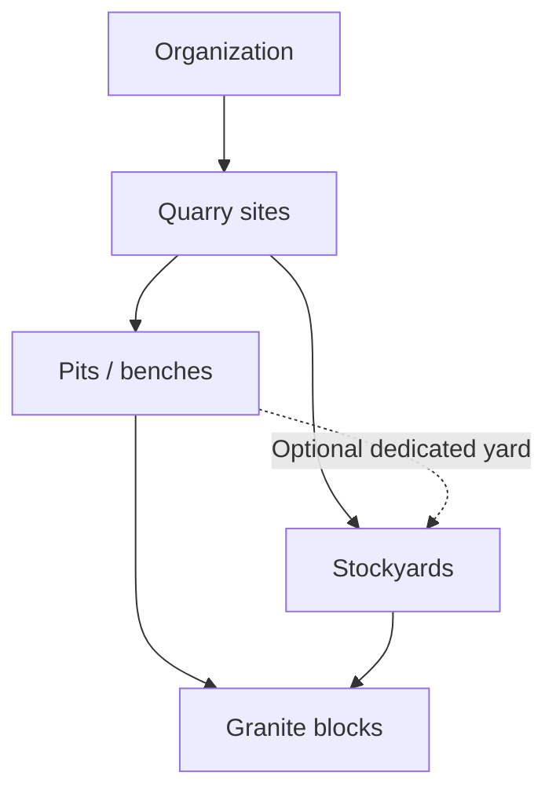

# QuarryOne V0.4.1 — Configurable onboarding

Status: proposed architecture, local SQL drafts only. No onboarding screen, authentication client or Supabase project is implemented or connected. The approved app, shared mock store and operational behavior remain unchanged.

## Organization and site model

An organization is the tenant boundary. Every business gets site-capable tables from day one; `organization_settings.multi_site_enabled BOOLEAN NOT NULL DEFAULT FALSE` controls the experience, not permission checks.

Each block belongs to one organization, site, pit and stockyard. Stockyards are site-scoped and may optionally serve one pit; a shared site yard can receive blocks from multiple pits. Dedicated-yard assignments must agree with the block's pit. This avoids incorrectly forcing every physical stockyard into a single pit while retaining the requested hierarchy.

One primary quarry site is mandatory before review/activation. Single-site mode automatically binds future operational forms to that site and omits site pickers. It must never suppress accessible historical records. Multi-site mode shows authorized site choices only; it does not grant access to another site or organization.

## Five stages

| Stage                                                        | Mandatory before review                                                                                                                   | Optional / defaults                                                                                                                   |
| ------------------------------------------------------------ | ----------------------------------------------------------------------------------------------------------------------------------------- | ------------------------------------------------------------------------------------------------------------------------------------- |
| 1. Business Registration                                     | Verified non-anonymous owner identity, owner display name, business name, contact phone, business state                                   | Legal name, GSTIN; INR and Asia/Kolkata defaults                                                                                      |
| 2. Quarry Site Configuration                                 | One primary site; site name/code, state/district, at least one active pit or bench at each configured site                                | Address, extra pits; multi-site off by default; extra sites only after enabling                                                       |
| 3. Materials, Grades, Stockyards and Measurement Preferences | At least one supported material; grades A/B/C; at least one active stockyard at each configured site; valid units, precision and timezone | FT dimensions/CFT display; CFT 2 and m³ 3 display decimals; site overrides inherit organization defaults; dedicated-pit yard optional |
| 4. Users and Roles                                           | At least one active owner; ownership and any site grants must be unambiguous                                                              | Owner-only business may skip invitations; other staff and site assignments optional                                                   |
| 5. Review and Activation                                     | All previous stage requirements revalidated on server                                                                                     | Review summary, edit links; no production opening balances required to activate                                                       |

DRAFT rows may be incomplete. Business phone/state and site location fields can be null until review; defaults allow preferences to be usable immediately. Unfinished invitations must not prevent an owner-only business activating, and never create effective memberships.

## Lifecycle and saving

`DRAFT → READY_FOR_REVIEW → ACTIVE`. A reviewer may return READY_FOR_REVIEW to DRAFT to correct configuration. ACTIVE cannot revert to DRAFT, and DRAFT cannot skip review. Operational data is accepted only by future authorized write operations for ACTIVE organizations and OPERATIONAL sites. New sites created later remain SETUP until separately validated and activated.

Proposed UI save contract: save an explicit field whitelist for the current stage in a short server transaction, require an expected settings revision, lock the organization first, validate supplied fields but allow missing later-stage fields, increment the revision and return the saved stage/revision. Resume by reading authoritative draft rows and recomputing completion; `onboarding_stage` is a navigation bookmark, not proof of readiness. Concurrent stale saves return a conflict and prompt refresh. A failed save retains entered fields and offers retry; no silent discard or premature success.

The SQL prototypes include idempotent bootstrap, site creation, mode switching, lifecycle transitions and existing-member/site-grant changes. Stage-field save, profile editing, invitation delivery/acceptance and new-site activation contracts are specified here for later implementation; they are deliberately not exposed as generic JSON-to-row update functions. SQL fixtures simulate trusted stage saves for validation. No app persistence or server integration is added now.

Bootstrap uses a caller-generated request UUID plus the verified `auth.uid()`. The same user/key/business name returns the same organization; mismatched business-name reuse fails. It atomically creates the profile if missing, organization, settings, fixed OWNER/ALL_SITES membership and audit event. There is no caller-supplied owner ID or role. Existing profile display names are retained. Rate limits and abandoned-draft cleanup belong in the later server rollout.

Review and activation each lock the organization, check admin membership and revision, and inspect actual configuration. Activation creates no blocks, customers, balances or fabricated operating history; it marks configured SETUP sites OPERATIONAL. Activation timestamps and audit events are written in the same transaction.

## Single-site to multi-site upgrade

1. Owner/Admin opens Settings → Quarry Management and reviews the implications.
2. The controlled operation checks authoritative membership and an expected revision, locks the organization, enables multi-site and audits the change.
3. Primary site, block identities, production dates, permissions and financial history are preserved; no rows are moved or copied.
4. Admin creates additional SETUP sites, configures their pits/yards and grants staff access explicitly. New-site activation remains a later controlled operation.
5. Future site selectors use allowed sites, with an All authorized sites choice for permitted consolidated reporting.

Disabling is a controlled transition, never a direct client setting update. Reject it if there is more than one non-archived site, any block history outside the primary site, or any site membership outside the primary site (including inactive grants). Empty, unassigned archived setup sites are harmless; archived sites with history are not. The drafts never remove history, revoke grants or reassign blocks to make disabling succeed. Before future Sales/Dispatch/Expenses integration, extend the guard to every site's financial and operational history. The UI should show the concrete blocker and retain multi-site mode.

## Mobile UI specifications — no screens implemented

Use approved Deep Slate #263238 headers, white navigation/title, Safety Orange #F57C00 primary actions and Stone White #F5F6F4 background. Reuse current cards, labels, numeric keyboards and safe-area patterns. Minimum 48px targets, visible save status, keyboard-safe scrolling, readable inline errors and 360/390/412px acceptance are required for the eventual UI.

| Specification                         | Proposed content and behavior                                                                                                                                                        |
| ------------------------------------- | ------------------------------------------------------------------------------------------------------------------------------------------------------------------------------------ |
| Business Registration                 | Business/owner details; required markers; optional legal/GST fields; Save & continue and Save draft; authentication verification precedes tenant creation                            |
| Single/Multi Quarry Configuration     | Default one quarry; concise optional toggle explaining additional sites; no repeated selector in single-site mode; authorized users alone may change mode                            |
| Quarry and Pit Setup                  | Primary site basics; one pit row by default; add/remove unused setup rows with clear validation; shared or dedicated stockyard choice in the next stage                              |
| Materials and Measurement Preferences | Select supported materials; configure A/B/C descriptions; yard names; FT/M input and CFT/m³ display choices; demonstrate 10×5×4 FT = 200 CFT ≈ 5.66 m³; no rounding of stored volume |
| User Invitations                      | Email or supported verified phone invitation, role, allowed sites, pending/revoked/expired states; owner row fixed; optional Skip for now; no membership until verified acceptance   |
| Review and Activate                   | Business/site/catalog/preferences/roles summary, missing-field links and explicit Activate; server validation authoritative; errors map to the affected stage                        |
| Settings → Quarry Management          | Primary and other sites with SETUP/OPERATIONAL/ARCHIVED labels, mode switch, blocked-disable explanation, add/configure site, assignments and archived-history access                |

Invitation design: a later trusted service stores an expiring, single-use hashed token and immutable organization/role/site scope, verifies the recipient's Auth identity/channel, and transactionally creates a profile/membership/grants with same-tenant constraints. Accepting users cannot override the role or tenant. Only Owner may invite OWNER/ADMIN; Admin may invite operational roles. Delivery is a retriable outbox operation after transaction commit. No invitation SQL, delivery service or authentication UI is deployed in V0.4.1.

## Acceptance criteria

- A new business starts DRAFT/single-site with an active owner, and cannot activate without one primary configured site.
- Incomplete fields survive a future stage save/resume; revision conflicts and validation errors are visible.
- Review/activation are transactional, authorized and do not invent inventory or history.
- Single-site forms bind the primary site without unnecessary selectors.
- Enabling adds no implicit site permissions and changes no existing operational records.
- Unsafe disabling is rejected, including archived secondary history and lingering site grants.
- Cross-tenant IDs cannot be linked by foreign keys; non-admins cannot change memberships or lifecycle.
- The current app stays unchanged until a separately reviewed integration milestone.

Open decisions for architectural review: one pit per yard versus shared yards (shared proposed); acceptable block-number annual capacity; future verified phone invitation UX; whether activation also needs a second approver; cleanup/retention rules for abandoned drafts.
